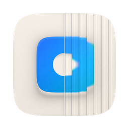

<p align="center"></p>

<h1 align="center">TwimShelf</h1>

<p align="center">把 X 上的帖子保存到本地</p>

TwimShelf  能把你喜欢的帖子、图片和视频保存到自己的设备上，不必担心作者删帖或注销。资料库存储在本地，多台设备之间通过局域网直接同步

后端用 Rust 编写，苹果平台有原生界面版本，其他平台使用 Flutter 版本，两者共用同一个核心和资料库格式。

## 可以做什么

- **收集媒体**：粘贴链接下载单条帖子，或者导入第三方扩展导出的收藏夹 JSON 批量下载。登录账号后可以保存你有权查看的锁定帖子
- **浏览与搜索**：首页随机出现已保存的内容，每次打开都有新鲜感；支持按标签、正文、作者等条件组合筛选，照片库的缩放手感向 Apple 相册看齐
- **AI 标记**：根据媒体和帖子内容自动打标签。可以从内置的模型商店下载本地模型，也可以接入外部 AI 服务，例如 Grok
- **设备间同步**：在局域网内配对设备后去中心化同步，不需要 iCloud，也不需要付费开发者账号
- **备份与维护**：可导出媒体，也可以导出完整包做冷备份

## 注意

程序目前处于早期预览状态，可能存在未知的问题。Linux平台未经验证，也未在MTK设备上进行本地AI推理验证


## 支持的平台

| 平台 | 版本 | 最低系统 | 安装包 |
| --- | --- | --- | --- |
| macOS | 原生 | macOS 15，Apple Silicon | `.dmg` |
| iPhone、iPad | 原生 | iOS 18 | 未签名 `.ipa` |
| Android | Flutter | Android 12 | `.apk` |
| Windows | Flutter | Windows 10 1803 | `setup.exe` |
| Linux | Flutter | 见[构建指南](BUILDING.md) | `.AppImage` |
| macOS、iPhone、iPad | Flutter | macOS 14、iOS 17 | `.dmg`、未签名 `.ipa` |

苹果平台上推荐使用原生版。Flutter 版主要面向其他平台，同样提供苹果平台的安装包。

## 下载

在 [Releases](https://github.com/XGWYTWGDYU/TwimShelf/releases/latest) 页面下载。所有安装包都由 [GitHub Actions](.github/workflows/build.yml) 从公开源码自动构建，`SHA256SUMS.txt` 里有校验值。

- **macOS**：安装包是临时签名（ad-hoc），没有经过公证。首次打开时系统会阻止，使用xattr命令清除隔离标签即可
- **iPhone、iPad**：`.ipa` 没有签名，需要用自己的证书或侧载工具重新签名后安装
- **Android**：大多数手机选择 `arm64-v8a`
- **Windows**：安装程序没有代码签名，SmartScreen 提示时选择「更多信息 › 仍要运行」
- **Linux**：`chmod +x` 之后直接运行 `.AppImage`

从 1.0.x 升级原生版时，直接覆盖安装即可，资料库、模型和设置都会保留。

## 从源码构建

克隆后运行脚本，或者打开 Xcode 选择自己的开发者账号点击构建即可，仓库里没有任何需要替换的个人配置。

```bash
git clone https://github.com/XGWYTWGDYU/TwimShelf.git
```

```bash
cd TwimShelf
```

```bash
./build.sh
```

Windows 上运行 `powershell -ExecutionPolicy Bypass -File build.ps1`。详细说明、Xcode 的用法和常见问题见 **[构建指南](BUILDING.md)**。

Bundle ID 和包名、版本号、签名、分享扩展开关、构建目录都集中在 [`config.yaml`](config.yaml) 里修改。图标来自根目录的 `icon.png`。

## 源码结构

| 目录 | 内容 |
| --- | --- |
| `core` | Rust 核心：数据库、下载、导入、同步、搜索、资料库管理 |
| `native` | 原生苹果版：`Shared` 共享代码，`iOS`、`macOS` 平台界面，`ShareExtension` 分享扩展，`TLLocalAI` 本地模型引擎 |
| `flutter/app` | Flutter 版应用 |
| `flutter/installer` | Windows 安装程序 |
| `flutter/tl_core`、`tl_native`、`tl_llama` | Flutter 插件：Rust 核心绑定、平台能力、llama.cpp 推理 |
| `scripts` | 配置生成、图标、打包和检查脚本 |
| `.github/workflows` | 自动构建和发布 |

## 参与贡献

欢迎通过 Issue 反馈问题，或者通过 Pull Request 提交改进。涉及数据库或同步协议的修改，请补充能够验证数据一致性的测试。请不要提交个人签名配置、真实账号凭据、媒体或真实的资料库，测试请使用合成数据（[说明](docs/testdata.md)）。

## 许可证

项目代码采用 [MIT 许可证](LICENSE)。第三方依赖和应用内下载的模型适用各自的许可证，每个发布版本都附有 `THIRD-PARTY-NOTICES.txt`。

TwimShelf 是独立项目，与 Twitter / X 没有隶属关系。保存内容的权利仍属于各自的权利人，请仅供个人使用，不要用于再分发。
