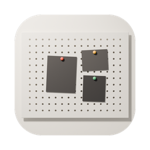
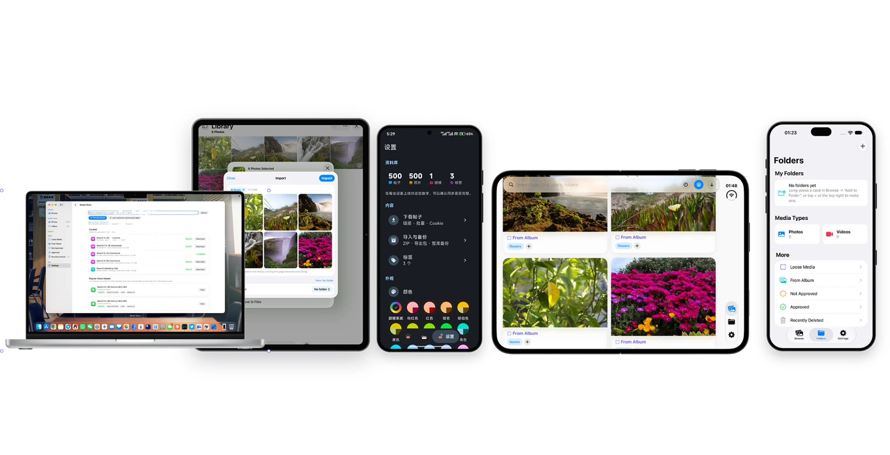

<p align="center"></p>

<h1 align="center">TwimShelf</h1>

<p align="center">把 X 上的帖子保存到本地</p>

<p align="center"></p>

TwimShelf  能把你喜欢的帖子媒体存储到本地资料库，不必担心作者删帖或注销，还可以使用AI标记媒体，在局域网进行p2p同步

后端基于rust，Apple平台和Windows有原生前端（Windows 版基于 WinUI 3），Linux/Android目前仅限Flutter前端，基于MD3+MD3E设计

## 介绍

- **收集媒体**：粘贴链接即可下载帖子，也支持导入第三方扩展导出的收藏夹 JSON 批量下载，对于锁定账户，添加cookie后可以下载你有权查看的锁定帖子
- **浏览与搜索**：主页采用随机展示，每次打开都有新鲜感。支持按标签、正文、作者等条件组合筛选
- **AI 标记**：根据媒体和帖子内容自动打标签。可以从内置的模型商店下载本地模型，也可以接入外部 API。连不上 Hugging Face 时，可以用环境变量 `HF_ENDPOINT` 指定镜像地址
- **设备间同步**：在局域网内去中心化同步，适合一般用户
- **备份与维护**：可按筛选条件批量导出媒体，也可以导出完整包做冷备份
- **Linux 服务器**：得益于 Flutter 支持 Web 的特性，可在局域网内的 NAS 或任何 HomeLab 上部署它，并访问 WebUI 前端
- **浏览器扩展**：在 X 网页上一键下载

## 注意

程序目前处于早期预览状态，可能存在未知的问题。Linux平台未经验证，Windows平台验证较少，也未在MTK设备上进行本地AI推理验证


## 支持的平台

| 平台 | 版本 | 最低系统版本 | 安装包 |
| --- | --- | --- | --- |
| macOS | 原生 | macOS 15，Apple Silicon | `.dmg` |
| iPhone、iPad | 原生 | iOS 18 | 未签名 `.ipa` |
| Android | Flutter | Android 12 | `.apk` |
| Windows | 原生（WinUI 3） | Windows 11 | `setup.exe` |
| Linux | Flutter | 见[构建指南](BUILDING.md) | `.AppImage` |
| iPhone、iPad | Flutter | iOS 18 | 未签名 `.ipa`（方便在苹果设备上测试 Flutter 版） |
| Linux 服务器 | 服务器 + 网页版 | Docker（x86_64、arm64） | Docker 镜像 `ghcr.io/xgwytwgdyu/twimshelf` |
| Chrome、Edge 等 | 浏览器扩展 | Chromium 116 | 仓库里的 `extension` 目录 |


## 下载

在 [Releases](https://github.com/XGWYTWGDYU/TwimShelf/releases/latest) 页面下载。所有安装包都由 [GitHub Actions](.github/workflows/build.yml) 从公开源码自动构建，`SHA256SUMS.txt` 中包含校验值。

- **macOS**：安装包采用ad-hoc签名，未经公证。首次打开时系统会阻止，使用xattr命令清除隔离标签即可
- **iPhone、iPad**：`.ipa` 同样没有签名，需要用自己的侧载工具重新签名后安装
- **Android**：对于现代设备，下载 `arm64-v8a`
- **Windows**：安装程序没有代码签名，如遇到 SmartScreen 提示时选择「更多信息 › 仍要运行」
- **Linux**：`chmod +x` 之后直接运行 `.AppImage`
- **Linux 服务器**：Docker 镜像发布在 GitHub Container Registry，见下文
- **浏览器扩展**：直接加载仓库里的 `extension` 目录，见下文

从旧版本升级时直接覆盖安装即可，资料库不会丢失

## Linux 服务器（Docker）

适合放在一台常开的 Linux 机器上：用浏览器访问资料库，和其他设备局域网同步，接收浏览器扩展发来的下载。

```bash
docker run -d --name twimshelf --restart unless-stopped -p 2778:2778 -v /srv/twimshelf:/data ghcr.io/xgwytwgdyu/twimshelf:latest
```

1. 用浏览器打开 `http://<服务器地址>:2778`。
2. 第一次的登录密码在 `docker logs twimshelf` 里。
3. 用 `docker exec -it twimshelf twimshelf passwd` 改成自己的密码。

程序在容器的 `/app`，数据都在 `/data`，端口和数据目录可以随意映射。默认只接受局域网访问；局域网同步需要 host 网络。更新时拉取新镜像、重建容器即可，数据不动。环境变量、公网访问、更新和 GPU 的说明见 [docker/README.md](docker/README.md)。

## 浏览器扩展

在帖子旁加下载按钮，点击可发送到绑定的设备下载，支持绑定浏览器扩展的版本有：Windows、Linux、macOS 上的 App 和 Linux 服务器
1. **安装**：在项目GitHub主页点击code➡️download zip，解压后在 Chrome 或 Edge 打开 `chrome://extensions`，打开「开发者模式」，点「加载已解压的扩展程序」，选择解压目录的 `extension` 文件夹，注意，Chromium不会为加载的扩展建立副本，若删除extension文件夹，扩展将失效。扩展也会发布更新，请自行克隆仓库并加载新版本
2. **绑定**：在 TwimShelf 里打开「设置 → 浏览器扩展 → 绑定浏览器」。
   - 同一台电脑上的 App：在扩展里输入 6 位绑定码。
   - 其他电脑或 Linux 服务器：复制「绑定文本」，粘贴到扩展里。

桌面版 App 打开时才能接收（端口 27800 起，只接受本机和局域网），Linux 服务器随时接收。详见 [extension/README.md](extension/README.md)。

## 从源码构建

克隆后运行脚本，或者打开 Xcode 选择自己的开发者账号点击构建即可，仓库里没有任何需要替换的个人配置。

```bash
git clone https://github.com/XGWYTWGDYU/TwimShelf.git
```

```bash
cd TwimShelf
```

```bash
./build.sh
```

Windows 上运行 `powershell -ExecutionPolicy Bypass -File build.ps1`。详细说明、Xcode 的用法和常见问题见 **[构建指南](BUILDING.md)**。

Bundle ID 和包名、版本号、签名、分享扩展开关、构建目录都集中在 [`config.yaml`](config.yaml) 里修改。图标来自根目录的 `icon.png`。只在自己电脑上用的值（自己的团队、Bundle ID、图标等）写进不进 Git 的 `config.local.yaml`，见[构建指南](BUILDING.md#本机配置configlocalyaml)。

## 源码结构

| 目录 | 内容 |
| --- | --- |
| `core` | Rust 核心：数据库、下载、导入、同步、搜索、资料库管理（和 `server` 同属根目录的 Cargo workspace） |
| `Apple` | 原生苹果版（工程由 XcodeGen 按根目录的 `project.yml` 生成）：`Shared` 共享代码，`iOS`、`macOS` 平台界面，`ShareExtension` 分享扩展，`TLLocalAI` 本地模型引擎 |
| `flutter/app` | Flutter 版应用 |
| `windows` | 原生 Windows 版：`TwimShelf`（WinUI 3，.NET，原生 AOT；也是自己的安装和卸载程序），`Setup/stub` 安装包外壳 |
| `flutter/tl_core`、`tl_native`、`tl_llama` | Flutter 插件：Rust 核心绑定、平台能力、llama.cpp 推理 |
| `server` | Linux 服务器：把核心通过 HTTP 提供给网页版，以及登录、文件、视频封面 |
| `docker` | Docker 镜像和 compose 示例 |
| `extension` | Chromium 浏览器扩展（独立项目，构建脚本不处理它） |
| `scripts` | 配置生成、图标、打包和检查脚本 |
| `.github/workflows` | 自动构建和发布 |

## 参与贡献

欢迎通过 Issue 反馈问题，或者通过 Pull Request 提交改进。个人签名配置请写进 `config.local.yaml`

## 许可证

项目代码采用 [MIT 许可证](LICENSE)。第三方依赖和应用内下载的模型适用各自的许可证，每个发布版本都附有 `THIRD-PARTY-NOTICES.txt`。

TwimShelf 是独立项目，与 Twitter / X 没有隶属关系。保存内容的权利仍属于各自的权利人，仅供个人使用，不要用于再分发。
